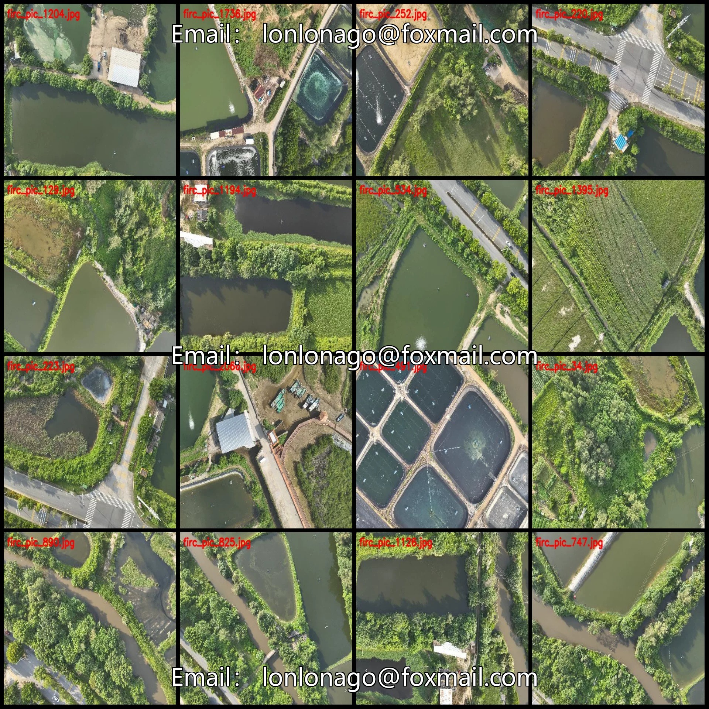
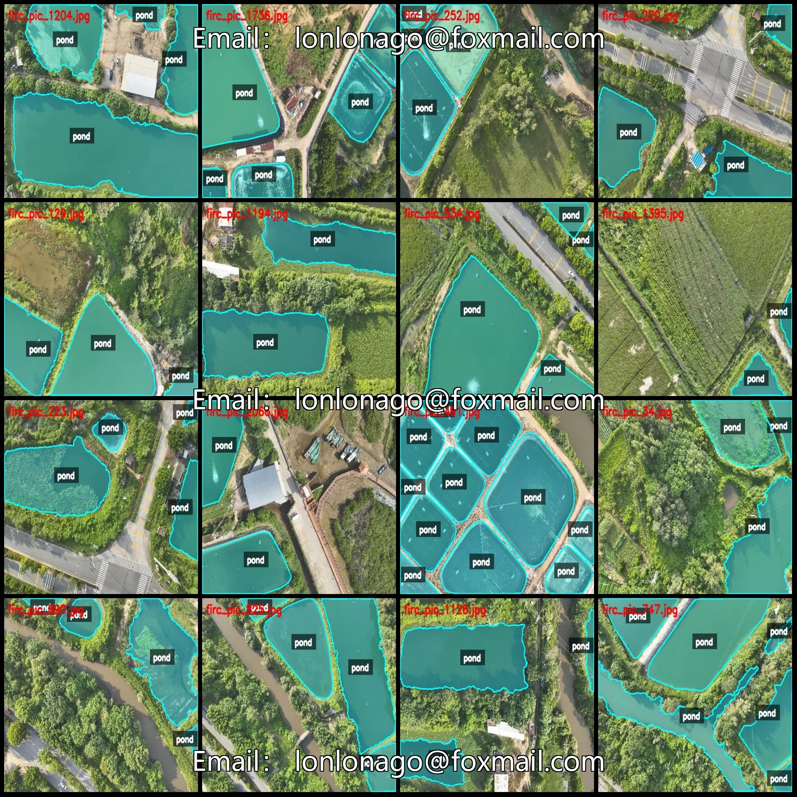
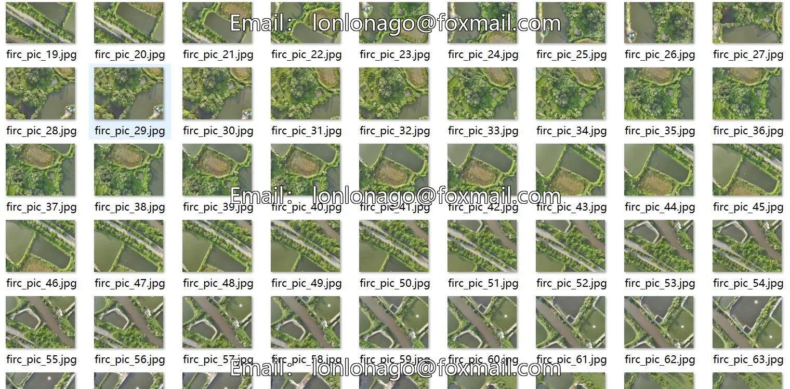
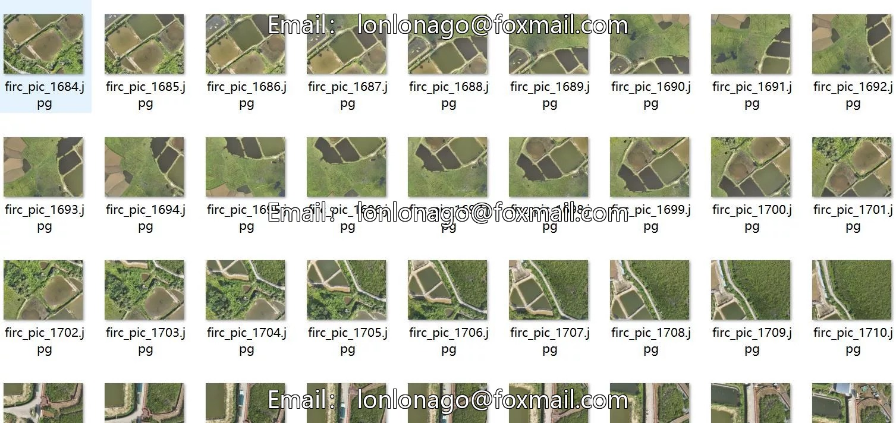
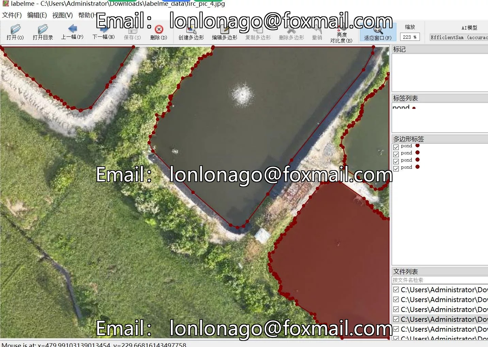

# UAV aerial photography enclosed pond identification and segmentation dataset labeled in LabelMe format - 2078 images

## Body

Drone-View Aerial Photography Dataset for Identification and Segmentation of Ponds in a Tract - LabelMe Format - 2078 Images, 1 Category

Warm Reminder: Due to the dataset's replicability, please confirm compliance with requirements before purchasing.

Dataset Format: LabelMe format (excluding mask files, only containing jpg images and corresponding json files)
Number of Images (Total jpg files): 2078
Number of Annotations (Total json files): 2078
Number of Annotation Categories: 1
Annotation Category Name: "pond"
Number of Boxes per Category: 8938
Total Boxes: 8938
Annotation Tool Used: labelme=5.5.0
Image Resolution: 512x384

Annotation rules: Polygons are drawn around the categories.
Important note: The dataset can be opened and edited using LabelMe, and for JSON datasets, they need to be converted into mask or Yolo format or Coco format for semantic segmentation or instance segmentation.
Special notice: This dataset does not guarantee any accuracy in the trained models or weight files.

## Images

## Payment

Here is a pay link on Stripe ( https://buy.stripe.com/3cs8yP7sY87d0vu9AB ). Please contact me lonlonago@foxmail.com after funding $89, and I will send you a complete data files , thank you!

